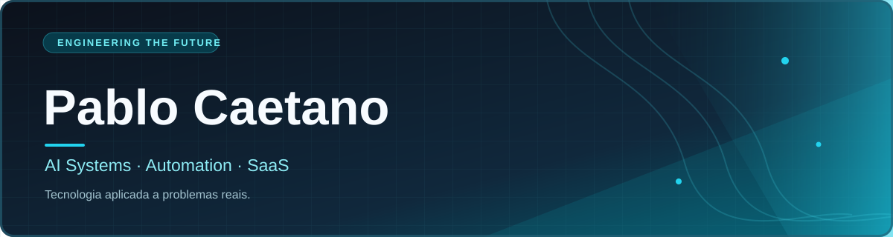

<!-- Perfil público de Pablo Caetano | github.com/pablocaetanos -->

<div align="center">



<br />

**Construindo sistemas inteligentes que conectam tecnologia a resultados reais.**

<a href="https://d1marketing.com.br"></a>
<a href="https://github.com/pablocaetanos"></a>


</div>

## 👨‍💻 Sobre mim

Sou **Pablo Caetano**. Trabalho na interseção entre **inteligência artificial, engenharia de software, automação de processos e criação de produtos digitais**.

Meu foco é transformar operações complexas em soluções práticas: agentes de IA, sistemas SaaS, integrações entre APIs, fluxos automatizados e painéis orientados por dados.

- 🤖 **Agentes inteligentes:** atendimento, agendamentos, operações e integrações com ferramentas de negócio.
- 🔄 **Automações:** orquestração de processos, webhooks, filas e sincronização de dados.
- 🧩 **Produtos SaaS:** aplicações com autenticação, bancos de dados e infraestrutura escalável.
- 📊 **Dados e BI:** indicadores operacionais, dashboards e acompanhamento de performance.
- 🚀 **Na prática:** desenvolvimento de soluções conectadas ao ecossistema da **D1 Marketing**.

## 🚀 Projetos em destaque

> Projetos de portfólio. Os repositórios de produção permanecem privados; os links públicos serão adicionados quando houver versões demonstráveis.

| Projeto | O que faz | Foco técnico |
| --- | --- | --- |
| **IA Barber** | Assistente de WhatsApp conectado à agenda de barbearias, com marcação, remarcação e cancelamento de horários. | Agentes de IA · APIs · n8n |
| **DispFacil** | Plataforma SaaS com ferramentas para operação e atendimento via WhatsApp. | SaaS · Integrações · Automações |
| **D1 Connect** | Camada de integração com a API Oficial do WhatsApp para produtos e fluxos empresariais. | APIs · Webhooks · Mensageria |
| **Omni D1** | Plataforma de gestão de projetos, entregas e indicadores operacionais. | BI · Gestão · Aplicações Web |
| **WebZapp IA** | Automação de atendimento e operações comerciais com agentes inteligentes. | LLMs · Orquestração · Observabilidade |

## 🧠 O que estou construindo

```text
Ideia e processo de negócio
           │
           ▼
  Aplicação / Interface
           │
           ▼
  APIs e automações (n8n)
           │
           ▼
 Agentes de IA + regras
           │
           ▼
 PostgreSQL / Supabase
           │
           ▼
 Logs, métricas e melhoria contínua
```

## 🛠️ Stack de trabalho

<div align="center">

**Linguagens e desenvolvimento**


**Automação, IA e dados**


**Infraestrutura e entrega**


</div>

## 📈 GitHub em números

<div align="center">

<!-- Cards de terceiros: podem apresentar dados limitados quando os projetos são privados. -->


</div>

> **Nota:** os cartões usam apenas os dados públicos disponíveis ao serviço externo. Repositórios privados não são expostos automaticamente.

## 🔗 Onde me encontrar

- 🌐 **D1 Marketing:** [d1marketing.com.br](https://d1marketing.com.br)
- 💻 **GitHub:** [github.com/pablocaetanos](https://github.com/pablocaetanos)

---

<div align="center">
  <sub>Inteligência artificial • Automações • SaaS • Dados</sub>
</div>
